<div align="center">

<a href="https://nuhmanpk.github.io/livatar/"></a>

# livatar

**Avatars that are alive.**

[](https://www.npmjs.com/package/livatar)
[](https://www.npmjs.com/package/livatar)
[](https://bundlephobia.com/package/livatar)
[](https://www.npmjs.com/package/livatar?activeTab=dependencies)
[](https://www.npmjs.com/package/livatar)
[](https://bundlephobia.com/package/livatar)
[](LICENSE)
[](https://github.com/nuhmanpk/livatar/actions/workflows/pages.yml)
[](https://nuhmanpk.github.io/livatar/)
[](https://github.com/nuhmanpk/livatar/commits/main)
[](https://github.com/nuhmanpk/livatar/issues)
[](https://github.com/nuhmanpk/livatar/pulls)
[](https://github.com/nuhmanpk/livatar)


**[Live demo and avatar builder →](https://nuhmanpk.github.io/livatar/)**

<a href="https://nuhmanpk.github.io/livatar/"></a>

<sub>Animated preview. Open the <a href="https://nuhmanpk.github.io/livatar/">live demo</a> to play with the real thing.</sub>

</div>

Tiny, zero-dependency SVG characters that follow your cursor, blink, breathe, chew when you type, watch your caret, cover their eyes when you type a password, and show ten moods.

- **27 characters.** Realistic humans from baby to grandparent, cartoon humans, a developer at work (coding, debugging, shipping…), Memoji-style 3D heads, clay people, 16 animals and birds, dinosaurs, aliens, planets, kawaii food, fruit, drinks, potted plants, living UI icons, devices, servers, vehicles, money, home and office things, robots, monsters, ghosts, emoji, initials, pixel critters, and blobs. Each has its own options.
- **10 moods.** `happy`, `sad`, `angry`, `surprised`, `sleepy`, `love`, `wink`, `silly`, `confused`, and `neutral`. They work in static SVG and change live with `handle.emote()`.
- **One code per avatar.** Every look packs into a short, URL-safe string such as `lvAQQBAG51aG1hbnBr`. Store it with the user and render it anywhere.
- **Light.** One style plus the engine is about 9 KB gzipped. Styles are tree-shakable, so you only ship the ones you import.
- **Runs anywhere.** ESM, CJS, `<script>` CDN, a web component, React, Vue, Svelte, Angular, SSR, ``, and email (static).
- **Deterministic.** The same seed always gives the same avatar, on the server and in the browser.
- **Animated icons.** 540+ brand icons and badges (GitHub, LinkedIn, Kaggle, Hugging Face, npm, Buy Me a Coffee, and more) with 12 animations that play even in READMEs.
- **Polite.** One shared `requestAnimationFrame` loop drives every avatar. It pauses avatars that are off screen and stops when the tab is hidden. It respects `prefers-reduced-motion`.
- **Pluggable.** A style is a plain object and a behavior is a plain function. Any SVG can come alive with `data-lv-*` attributes.

## Characters

| Style | What it is | |
| --- | --- | --- |
| `buddy` | Cartoon humans: 10 hair styles, beards, glasses, hats, headphones, clothes |  |
| `animal` | 16 sticker-style animals and birds |  |
| `monster` | Fuzzy monsters with 1 to 3 eyes, horns, and fangs |  |
| `ghost` | Little sheet ghosts with hats, bows, crowns, and halos |  |
| `emoji` | Classic round smileys, the best canvas for moods |  |
| `bot` | Robots with LED eyes |  |
| `blob` | Abstract gradient creatures | 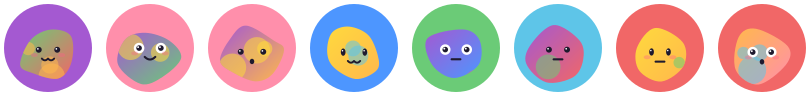 |
| `pixel` | Mirrored pixel critters | 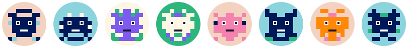 |
| `memoji` | Glossy 3D-style heads: curly tops, beards, aviators |  |
| `clay` | Soft claymorphism people |  |
| `planet` | Earth, Saturn, the Moon, the Sun, comets |  |
| `dino` | T-rex, triceratops, stego, bronto, ptero, dragon |  |
| `alien` | Friendly aliens with 1–3 eyes and helmets |  |
| `food` | Kawaii avocado, donut, sushi, boba, and more |  |
| `plant` | Potted cacti, succulents, monstera, mushrooms |  |
| `initials` | Initials with a tiny living face | 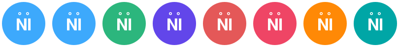 |

The `animal` species are cat, dog, bear, bunny, fox, panda, frog, mouse, shark, penguin, owl, chick, parrot, pig, koala, and lion:

<br>


## Moods

<br>
<br>
<br>

<sub>neutral · happy · sad · angry · surprised · sleepy · love · wink · silly · confused</sub>

```js
createAvatar(animal, { seed: 'ada', mood: 'love' })  // static, works in  and email

const h = mount(el, animal, { seed: 'ada' })
h.emote('happy')         // switch mood
h.emote('surprised', 800) // react for a moment, then go back
h.nod(); h.shake()        // yes / no
```

Moods move differently too. Happy avatars bounce, angry ones tremble, sad ones look down, sleepy ones breathe slowly, and confused ones tilt their heads. Clicking an avatar makes it look surprised for a moment. You can also let it doze off when nobody is around with `alive: { sleepAfter: 30000 }`.

### Use cases

<picture><source media="(prefers-color-scheme: dark)" srcset="assets/empty-dark.svg"></picture> <picture><source media="(prefers-color-scheme: dark)" srcset="assets/login-dark.svg"></picture>

<picture><source media="(prefers-color-scheme: dark)" srcset="assets/life-room-dark.svg"></picture>

<picture><source media="(prefers-color-scheme: dark)" srcset="assets/life-assistant-dark.svg"></picture>

Meeting rooms where everyone looks at the speaker, an AI assistant face, loading states, virtual pets and comment boxes that react (see [`livatar/life`](#give-it-a-life-livatarlife)). Empty states that feel alive, login forms that look away from your password, chat bots that talk while text streams, and form validation that reacts. `bindForm(handle, form)` wires native form validation to moods for you. See [all use cases](https://nuhmanpk.github.io/livatar/#use-cases).

### Animated icons

`livatar/icons` gives you 540+ brand icons and badges: socials, dev platforms, and sponsors. Each one is a standalone SVG with the animation inside, so it moves in an `` tag and in READMEs. Pick and copy them on the [icons page](https://nuhmanpk.github.io/livatar/icons/).

```js
import { icon, badge } from 'livatar/icons'

icon('github', { animation: 'wiggle', tile: 'circle', size: 32 })
badge('buymeacoffee', 'Buy me a coffee', { animation: 'tada' })
```

## Build it with an AI agent

livatar is made to be vibe-coded. Paste this into Claude Code, Cursor, Copilot, Codex, Windsurf, or any coding agent:

```text
Use livatar (npm i livatar) in this project. Read https://nuhmanpk.github.io/livatar/llms-full.txt
and https://nuhmanpk.github.io/livatar/SKILL.md first, then: <what you want, e.g. "animated avatars for every user in the sidebar">
```

- **One-click prompt:** hit **✨ Copy for AI agents** on the [site](https://nuhmanpk.github.io/livatar/), [docs](https://nuhmanpk.github.io/livatar/docs/) or [icons](https://nuhmanpk.github.io/livatar/icons/) page (every icon has its own).
- **Claude Code skill:** `npx livatar skill` installs it to `.claude/skills/livatar/`.
- **For any agent:** [`llms.txt`](https://nuhmanpk.github.io/livatar/llms.txt), [`llms-full.txt`](https://nuhmanpk.github.io/livatar/llms-full.txt), and [`AGENTS.md`](AGENTS.md) (shipped in the package at `node_modules/livatar/AGENTS.md`).

## Install

```bash
npm i livatar
```

## Use

### Vanilla

```js
import { mount, buddy } from 'livatar'

const handle = mount(document.querySelector('#me'), buddy, { seed: 'ada@example.com', mood: 'happy' })
handle.talk(1500) // animate speaking
```

### livatar codes

You can build an avatar in the [builder](https://nuhmanpk.github.io/livatar/) or in code, then save the result as a single string:

```js
import { encode, decode, render, mountCode } from 'livatar'

const code = encode({
  style: 'animal',
  seed: 'nuhmanpk',
  mood: 'happy',
  palette: 'ocean',
  options: { species: 'shark' },
})
// → 'lv…' (short, URL-safe, deterministic)

render(code)                  // '<svg …>' on the server, in , in email
mountCode(el, code)           // alive in the browser
decode(code)                  // back to the config object
```

A code holds the style, seed, mood, shape, flip, border, gradient, background, palette, colors, and every option you set. Options you leave out stay picked by the seed. Codes are versioned. Style and palette lists only ever grow, so old codes keep rendering the same avatar.

`mountCode`, `render`, and `decode` need every style, so using them adds all eight to your bundle (about 20 KB gzipped). `mount(el, style)` adds only the style you pass.

### Web component (any framework, no build step)

```html
<script type="module" src="https://unpkg.com/livatar/dist/element.js"></script>

<live-avatar seed="ada" variant="buddy" size="64" mood="happy"></live-avatar>
<live-avatar seed="r2" variant="animal" options='{"species":"owl"}' shape="rounded"></live-avatar>
<live-avatar code="lvAQQBAG51aG1hbnBr" size="48"></live-avatar>
```

Attributes:

| Attribute | Value |
| --- | --- |
| `code` | A livatar code. Other attributes override what it says. |
| `seed`, `variant` | Seed and style name: `buddy`, `animal`, `monster`, `ghost`, `emoji`, `bot`, `blob`, or `pixel` |
| `mood` | One of the ten moods |
| `options` | Style options as JSON, for example `'{"hair":"afro"}'` |
| `size` | A number in px or any CSS length |
| `shape` | `circle`, `rounded`, or `square` |
| `palette`, `colors` | A palette name, or comma-separated colors |
| `background` | A color or `none` |
| `gradient`, `flip`, `border`, `border-width` | Look tweaks |
| `label` | Accessible name |
| `intensity`, `sleep-after`, `static`, `no-track`, `no-keyboard`, `no-blink`, `no-poke` | Motion |

You can control it from JS: `document.querySelector('live-avatar').handle.emote('love', 1500)`.

### React

```jsx
import { Livatar } from 'livatar/react'
import { animal } from 'livatar'

const ref = useRef(null)
<Livatar ref={ref} seed={user.id} variant={animal} mood="happy" size={48} />
// ref.current.talk(800) on each streamed LLM chunk, ref.current.emote('sad') on errors
```

From a code: `const { style, options } = resolve(code)`, then `<Livatar variant={style} {...options} />`.

### Vue / Svelte / Angular

Use the web component: `import 'livatar/element'` and write `<live-avatar seed="…" />`. In Vue, tell the compiler about it with `compilerOptions.isCustomElement = t => t === 'live-avatar'`.

### CDN global

```html
<script src="https://unpkg.com/livatar"></script>
<script>Livatar.mount(el, Livatar.emoji, { seed: 'hi', mood: 'wink' })</script>
```

### Server, ``, and email (static)

```js
import { createAvatar, toDataUri, pixel } from 'livatar'

createAvatar(pixel, { seed: 'ada', size: 64 }) // '<svg …>'
toDataUri(pixel, { seed: 'ada' })              // 'data:image/svg+xml;utf8,…'
```

If you render SVG on the server, call `alive(el)` on the client to wake it up.

## Customize


### `createAvatar(style, options) → string`

| Option | Type | Default |
| --- | --- | --- |
| `seed` | `string \| number` | `'livatar'` |
| `mood` | one of the ten moods | `'neutral'` |
| `size` | `number \| string` | `100%` (fluid) |
| `shape` | `'circle' \| 'rounded' \| 'square'` | `'circle'` |
| `background` | `boolean \| string` | `true` (picked from the palette) |
| `gradient` | `boolean` | `false`. Uses a two-color diagonal background. |
| `colors` | `string[]` | the style's palette, or one of `palettes` |
| `border` | `boolean \| string` | `false`. Draws a ring; `true` picks a contrasting color. |
| `borderWidth` | `number` | `4` |
| `flip` | `boolean` | `false`. Mirrors the avatar; the gaze still follows the cursor correctly. |
| `title` | `string` | none (`aria-hidden`) |
| `className` | `string` | |
| `options` | style-specific options | |

Palettes: `import { palettes } from 'livatar'` gives you `pastel`, `vivid`, `candy`, `ocean`, `forest`, `sunset`, `mono`, `neon`, `retro`, and `earth`. Pass one as `colors: palettes.ocean`.

### Style options

Every option accepts `'random'` (the default), which means the seed picks it. `style.variants` lists the choices for each option, which is handy for building pickers.

- **buddy:**
  - `hair`: `short`, `curly`, `bun`, `spiky`, `long`, `beanie`, `bald`, `afro`, `mohawk`, `ponytail`
  - `facialHair`: `none`, `beard`, `mustache`, `stubble`, `goatee`
  - `glasses`: `false`, `round`, `square`, `sun`
  - `accessory`: `none`, `earrings`, `headphones`, `cap`, `bow`
  - `clothes`: `tee`, `hoodie`, `collar`, `vneck`
  - `mouth`, `freckles`, `skin`, `hairColor`
- **animal:** `species` (the 16 above), `fur`, `pattern` (`none`, `spots`, `stripe`), `whiskers`, `outline` (the sticker look; on by default)
- **monster:** `eyes` (`1`, `2`, `3`), `horns` (`none`, `small`, `curly`, `antenna`), `teeth` (`none`, `fangs`, `snaggle`), `spots`
- **ghost:** `accessory` (`none`, `bow`, `hat`, `crown`, `halo`), `blush`
- **emoji:** `tone` (`yellow`, `orange`, `pink`, `blue`, `green`), `eyes` (`dot`, `oval`, `sparkle`), `mouth` (`smile`, `grin`, `flat`, `o`), `blush`
- **bot:** `eyes` (`round`, `square`, `visor`, `happy`), `antenna` (`single`, `double`, `none`), `glow`
- **blob:** `eyes` (`dot`, `round`, `tall`, `happy`), `mouth` (`smile`, `grin`, `o`, `cat`, `flat`), `blush`, `spots`
- **pixel:** `density` (0 to 1)

## API

### `alive(element, options) → handle`

`element` can be the `<svg>` or any element that contains it. When there is no DOM (for example during SSR), `alive()` does nothing.

| Option | Default | Description |
| --- | --- | --- |
| `track` | `true` | Follow the mouse or touch pointer |
| `focus` | `true` | Look at the caret of the focused text field |
| `keyboard` | `true` | Mouth moves while you type; arrow keys steer the gaze |
| `shy` | `true` | On password fields: turn away, close eyes, and raise `data-lv-shy` parts (hands, paws, wings). Typing there never moves the mouth. |
| `blink` | `true` | Blink at random |
| `breathe` | `true` | Breathe subtly |
| `idle` | `true` | Let the gaze wander when the pointer has been idle |
| `poke` | `true` | Squash on click or tap and dispatch a `livatar:poke` event |
| `pokeMood` | `'surprised'` | Mood flashed when poked, or `false` |
| `sleepAfter` | `0` | Milliseconds without input before it dozes off. `0` means never. |
| `rerender` | set by `mount` | `(mood) => markup`. Lets `emote()` redraw the face. |
| `intensity` | `1` | How much everything moves |
| `speed` | `1` | How quickly movement is smoothed |
| `range` | auto | Distance in px at which the gaze reaches about 50% |
| `idleAfter` | `4000` | Milliseconds without pointer movement before `idle` starts |
| `reducedMotion` | `'auto'` | `'auto'` follows `prefers-reduced-motion`; `'ignore'` does not |
| `behaviors` | `[]` | Plugins (see below) |

The handle has these methods: `look(x, y, ms)`, `talk(ms)`, `blink()`, `poke()`, `emote(mood, ms?)`, `nod()`, `shake()`, `refresh()`, `set(options)`, `state`, and `destroy()`.

### `mount(el, style, { ...avatarOptions, alive })`

Renders the avatar into `el` and then calls `alive()`. Pass `alive: false` for a static avatar. `mountCode(el, code, opts)` does the same from a code, a style name, or a config object.

### Codes

`encode(config) → string`, `decode(code) → config`, `render(codeOrConfig, extra?) → svg`, `resolve(codeOrConfig) → { style, options }`, and `isCode(value)`. Each one takes an optional custom style registry as its last argument.

## Give it a life (`livatar/life`)

A separate entry point, so the core bundle stays the same size. Everything works on any handle.

<picture><source media="(prefers-color-scheme: dark)" srcset="assets/life-room-dark.svg"></picture>

<picture><source media="(prefers-color-scheme: dark)" srcset="assets/life-assistant-dark.svg"></picture>

**[Try it live: personality, AI face, pet, multiplayer →](https://nuhmanpk.github.io/livatar/life/)**

```js
import { mount, bot, animal, buddy } from 'livatar'
import { personality, assistant, pet, group, context, feel } from 'livatar/life'

// Personality: a preset, your own traits, or { seed } (same seed → same personality)
const me = personality(mount(el, buddy, { seed: user.id }), { seed: user.id })
me.name               // 'curious'
me.react('success')   // success error join leave mention celebrate agree disagree …

// Context: yawns at night, sad when offline, "welcome back" after you leave the tab
context(handle, { onEvent: me.react })

// The face of your AI: listening → thinking → speaking → done
const ai = assistant(mount(el, bot, { seed: 'helper' }))
ai.think()
const reply = await ai.stream(tokens)   // talks per token, ends with a mood from the reply
ai.speak(audioElement)                  // lip-sync to TTS audio

// Virtual pet: hunger, energy and happiness drift in real time, it levels up and grows
const mochi = pet(mount(el, animal, { seed: 'mochi' }), { onChange: drawBars })
mochi.feed(); mochi.play(); mochi.reward(10)

// Multiplayer: avatars look at whoever speaks, greet joiners, react to messages
const room = group()
socket.on('join', (u) => room.join(u.id, mount(slot(u), buddy, { seed: u.id })))
socket.on('msg', (m) => room.message(m.from, m.text))

feel('this is broken!!')   // 'angry' (tiny local sentiment, no model)
```

### React & Next.js components (`livatar/components`)

**[Browse all 34 with live previews and code →](https://nuhmanpk.github.io/livatar/components/)** Checkout (the card covers its eyes for the CVC), inline inputs with a face inside, search (an owl), one-time code, newsletter pill (a sprout that blooms), pricing, cookie consent, progress (a car), onboarding (a rocket), countdown, loader, login form, password strength, upload, cart, AI assistant, chat, meeting grid, toast, 404, avatar wall background and more. Each comes with a character that fits its job.

Ready-made and `'use client'`. They render the static avatar on the server and start behaving after hydration.

```tsx
import { bot, human } from 'livatar'
import { LivatarLoader, LivatarMeet, LivatarForm, LivatarAssistant, LivatarPet, LivatarStack, LivatarEmptyState, LivatarReaction } from 'livatar/components'

<LivatarLoader status={isPending ? 'loading' : 'success'} label="Fetching…" />
<LivatarMeet avatar={{ variant: human }} participants={[{ id: 'ada', speaking: true }, { id: 'bob' }]} />
<LivatarForm onSubmit={(data) => signIn(data)}>…your inputs…</LivatarForm>
<LivatarAssistant variant={bot} status={useChat().status} text={reply} />   // Vercel AI SDK status works as-is
<LivatarPet seed="mochi" />
<LivatarStack users={[{ id: 'ada', status: 'online' }, { id: 'bob', status: 'away' }]} />
<LivatarEmptyState title="No messages yet" action={<button>Refresh</button>} />
<LivatarReaction text={draft} />
```

Hooks for your own components: `usePersonality`, `useAssistant`, `usePet`, `useContextAware`.

## Make anything alive

The engine animates any element that has these attributes. It works with your own hand-drawn SVG too:

| Attribute | Effect |
| --- | --- |
| `data-lv-depth="0.8"` | Parallax: moves with the gaze by depth × 4 units. Nest groups to add depth. |
| `data-lv-tilt="5"` | Rotates with horizontal gaze (in degrees) |
| `data-lv-eye=""` | Blinks and closes |
| `data-lv-mouth="1"` | Opens when talking or typing (the value sets how much) |
| `data-lv-body=""` | Breathes, bounces with its mood, and squashes when poked |
| `data-lv-shy=""` | Hidden; slides up into view while a password field is focused (for example, hands over the eyes). Give it `opacity="0"` so static renders hide it. |
| `data-lv-float=""` | Bobs gently, for hearts and zzz. `data-lv-float="drip"` falls and fades, for tears. |

Put `data-lv-mood="happy"` on the root `<svg>` to get a mood's motion.

## Write your own style

```js
import { defineStyle, createAvatar } from 'livatar'

export const jelly = defineStyle({
  name: 'jelly',
  colors: ['#e0e7ff', '#fce7f3', '#dcfce7', '#fef9c3'],
  render: ({ rand, color, background }) => `
    <g data-lv-body="">
      <path data-lv-depth=".3" d="M22 92V58a28 28 0 0 1 56 0v34l-7-5-7 5-7-5-7 5-7-5-7 5-7-5z" fill="${color(background)}" stroke="#1f1a2e" stroke-width="2.5"/>
      <g data-lv-depth="1">
        <ellipse data-lv-eye="" cx="40" cy="58" rx="3.2" ry="${rand.float(3.5, 5)}" fill="#1f1a2e"/>
        <ellipse data-lv-eye="" cx="60" cy="58" rx="3.2" ry="4.2" fill="#1f1a2e"/>
        <ellipse data-lv-mouth="1.5" cx="50" cy="70" rx="4" ry="2" fill="#1f1a2e"/>
      </g>
    </g>`,
})
```


The `ctx` object passed to `render` contains:

- `rand`: a seeded generator with `.int`, `.float`, `.pick`, and `.bool`
- `pick(key, choices)`: the option's value, or a seeded pick from `choices` when the option is `'random'`
- `color(against?)`: the next palette color, chosen to contrast with `against` when you pass it
- `mood`: the mood to draw
- `background`, `colors`, `id` (a prefix for `<defs>` ids), `options`, and `seed`

To support moods, reuse the built-in expressions: `faceEyes`, `faceBrows`, `faceMouth`, and `faceExtras` take a small `FaceSpec` that says where your face is and how to draw an open eye. Every built-in style uses them.

Output must be valid XML, so write attributes as `data-lv-eye=""`, not a bare `data-lv-eye`.

## Write your own behavior

A behavior is a function that runs every frame. It can change the gaze target before smoothing:

```js
const followMoon = ({ target, now }) => {
  target.x = Math.cos(now / 1000)
  target.y = -0.5
}
alive(el, { behaviors: [followMoon] })
```

## Your own avatar API (one line)

`livatar/server` turns any runtime with web-standard `Request`/`Response` (Cloudflare Workers, Next.js route handlers, Deno, Bun, Netlify, Node 18+) into an avatar API, with alt text and long-lived caching built in:

```js
import { avatarHandler } from 'livatar/server'
export default { fetch: avatarHandler() }                      // Cloudflare / Bun / Deno
// export const GET = avatarHandler({ basePath: '/api/avatar' }) // Next.js app/api/avatar/[...slug]/route.ts
```

`/animal/ada.svg?mood=happy&species=owl&size=64`, `/initials/Ada%20Lovelace.svg`, or `/lvAQQ….svg` (a code).

### Alt text for free

`describe({ style: 'animal', mood: 'happy', options: { species: 'owl' } })` returns `"A happy owl"`. The server uses it for every avatar's accessible name.

## Develop

```bash
npm install
npm run demo    # build, watch src/, and serve the demo with live reload at http://localhost:5173/demo/
npm run build   # build dist/ (ESM, CJS, IIFE, and .d.ts)
npm test        # run the node:test suite
npm run serve   # serve without rebuilding (pass a port: npm run serve -- 8080)
npm run site    # assemble the GitHub Pages site into _site/
npm run art     # regenerate the animated README images in assets/
```

### Demo on GitHub Pages

`.github/workflows/pages.yml` builds, tests, and deploys the demo on every push to `main`.
Enable it once: **Settings → Pages → Build and deployment → Source: GitHub Actions**.
The demo is then live at `https://<user>.github.io/livatar/`.

## Credits

Inspired by [DiceBear](https://www.dicebear.com) (MIT) by Florian Körner and contributors — the reference for seeded avatar styles, including the idea behind our `initials` style and avatar HTTP API. Also by [boring-avatars](https://github.com/boringdesigners/boring-avatars), [avataaars](https://getavataaars.com), [RoboHash](https://robohash.org), and [minidenticons](https://github.com/laurentpayot/minidenticons). Brand icons come from [Simple Icons](https://simpleicons.org) (CC0).

## Contributing

See the [roadmap](ROADMAP.md) for planned work and good places to start.

Issues and PRs are welcome at [github.com/nuhmanpk/livatar](https://github.com/nuhmanpk/livatar). New styles, species, and behaviors are the easiest place to start.

## Support

If livatar saves you time, you can support it:

<p>
<a href="https://github.com/sponsors/nuhmanpk"></a>&nbsp;<a href="https://www.buymeacoffee.com/nuhmanpk"></a>&nbsp;<a href="https://github.com/nuhmanpk/livatar"></a>
</p>

## Author

**Nuhman PK** · [@nuhmanpk](https://github.com/nuhmanpk)

<p>
<a href="https://github.com/nuhmanpk"></a>&nbsp;<a href="https://www.linkedin.com/in/nuhmanpk"></a>&nbsp;<a href="https://www.kaggle.com/nuhmanpk"></a>&nbsp;<a href="https://huggingface.co/nuhmanpk"></a>&nbsp;<a href="https://x.com/nuhmanpk"></a>&nbsp;<a href="https://www.npmjs.com/package/livatar"></a>
</p>

<sub>These icons are livatar's own <a href="https://nuhmanpk.github.io/livatar/icons/">animated icons</a>. Grab any of the 540+ for your README.</sub>

## License

[MIT](LICENSE) © Nuhman PK


<p align="center">
  
</p>
